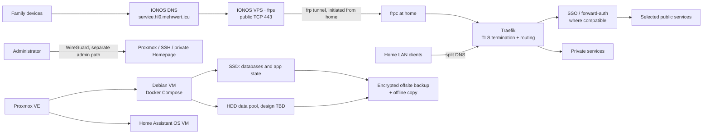

# Homelab Architecture Plan

**Status:** approved 2026-10-25 — implementation running on `pve2` (192.168.181.99). See *Implementation status* below.
**Language:** English.

## Goals and constraints

- Rebuild the environment from versioned configuration after a host or disk failure.
- Use Proxmox VE, OpenTofu, cloud-init, Docker Compose, and SOPS + age; no Kubernetes or Ansible.
- Serve family users, with selected services reachable remotely.
- No home-router port forwarding and no Cloudflare. An IONOS VPS is the public edge; the home connection is behind CGNAT.
- Target host: HP Spectre x360 13-ae043ng, i7-8550U, 16 GB soldered RAM, one M.2 slot, USB storage. RAM cannot be upgraded.[9]
- Treat 16 GB as a hard ceiling. Immich's documented baseline is already 6 GB RAM and two CPU cores; phase services in and measure real peaks.[12]

## Proposed architecture



- **Public edge:** frp is the leading proposal because it is a focused reverse tunnel with token authentication, while Pangolin's own VPS guidance recommends 2 GB RAM. Keep frp small: allow only the required ports, require authentication and encrypted tunnel transport, keep its admin interface private, and update it deliberately.[1][2][13]
- **TLS:** public HTTPS terminates at Traefik at home; obtain certificates with an IONOS DNS-01 challenge. The public VPS forwards traffic but holds no application data or routing policy.
- **Admin access:** keep Proxmox, SSH, and private dashboards off the public path. Use WireGuard as a separate management route; never expose the Proxmox UI through the service tunnel.
- **Services:** one Debian VM hosts Compose stacks; Home Assistant OS remains a separate VM. Start with a small set and add services only after measuring RAM. No per-service VM unless isolation or a specific appliance requirement justifies it.
- **Data:** M.2 for the host, databases, and application state. Bulk media may use per-disk filesystems plus mergerfs/SnapRAID after disk inventory. SnapRAID parity is not real-time, so it is not appropriate protection for frequently changing live databases.[8]
- **Backups:** keep guest/config backups, encrypted offsite copies of irreplaceable data, and an offline copy. SnapRAID and a second directory on the same disks are not independent backups. Perform a restore test before loading family data.

## Network and IP plan

The known home network is `192.168.176.0/21` with gateway `192.168.178.1`. The agreed address blocks are:

| Purpose | Reserved range |
|---|---|
| Primary / real lab | `192.168.181.100–150` |
| Disposable test lab | `192.168.181.200–250` |

Before assigning addresses, verify that neither block overlaps the FRITZ!Box DHCP pool or existing leases. Keep a small IP/name inventory in the architecture plan. Use stable addresses for infrastructure, not every short-lived guest.

**Addressing policy:**

- Prefer DHCP reservations for stable VMs, bound to explicitly stable virtual MAC addresses.
- If reservation is unavailable or unsuitable, configure a static address inside the reserved block and outside the DHCP pool.
- Use normal DHCP for disposable test guests.
- Do not mix static assignments and the DHCP pool; never rely on “that address looks unused.”

**Name resolution:** use DNS names, not literal IPs, in service settings. Compose services talk to each other by Compose service name. Use internal DNS for LAN-only names and split DNS for public service names. mDNS is useful for device discovery (including some smart-home devices), but not as the dependency for stable service-to-service connections.

## Remote access, Homepage, and SSO

Homepage should **not** be restricted to the tunnel by default. The useful default is one private Homepage behind SSO, available from the LAN and through WireGuard. A second, separate public overview is optional: list only intentionally public services and expose no internal names, admin links, API widgets, or credentials.

A reverse-proxy login gate is not automatically compatible with every native app. Prefer each service’s own login or native OIDC where supported. Immich supports OIDC and documents reverse-proxy requirements for headers and mobile endpoints; Home Assistant requires trusted-proxy configuration when reverse-proxied, so test browser and mobile-client flows.[3][4][5]

| Option | Advantages | Trade-offs | Proposed use |
|---|---|---|---|
| **Authelia** | Configuration in files; proxy authorization; good fit for a light login gate | More manual user/config management; test each app and client | First SSO pilot for Homepage and compatible browser-only services.[6] |
| **authentik** | Richer identity provider, UI, policies, and proxy provider for apps without native auth | More components and operational weight | Revisit if family self-service or broader OIDC/SAML management becomes important.[7] |
| **Tinyauth** | Small, simple proxy-auth layer | Not a full identity platform; fewer identity features | Alternative if a login wall is enough, not if full SSO is required |
| **Native app auth / OIDC** | Best compatibility with service APIs and mobile apps | Accounts may still be managed per service | Default for Immich, Nextcloud, Vaultwarden, and other native clients |
| **VPN-only** | Small public attack surface; simple service auth model | Family members need a VPN client | Default for Proxmox, SSH, Home Assistant administration, and internal dashboards |

**Initial exposure policy:** Homepage admin view, Proxmox, SSH, and Home Assistant are private/VPN-only. Public access is enabled service by service only after authentication, backups, and mobile-client tests pass. Vaultwarden must not be put behind a generic proxy login without testing Bitwarden clients; its own authentication remains required.

## Storage decision — deliberately not final yet

Do not finalize a pool or format disks until the inventory is complete: capacity, 2.5/3.5-inch, enclosure/bridge, power supply, SMART health, and data already on each disk.

- The laptop has one internal M.2 slot; it cannot provide an internal SSD mirror. A second SSD over Thunderbolt would still be an external device, not a reason to treat it as a reliable mirror.
- ZFS is not ruled out because ECC is mandatory: OpenZFS calls ECC strongly recommended, not required. For this laptop, USB-drive reliability, memory budget, and operating simplicity are the reasons to defer it.[11]
- For mostly static bulk files, mergerfs + SnapRAID is a candidate. Its parity must be synced and does not protect changes made since the last sync.[8]
- Do not store live databases on the SnapRAID pool. Keep app state and databases on SSD; back them up separately.
- Start with the simplest reliable set of powered drives. Add a multi-disk pool only if its power, enclosure, and USB stability are proven.
- RAID/parity improves availability; it does not replace an independent backup.

## Build sequence and gates

```mermaid
gantt
  title Proposed order — gates, not calendar promises
  dateFormat X
  axisFormat %s
  section Decide
  Inventory, IPs, exposure policy :p0, 0, 1
  section Rehearse
  Repeatable disposable lab       :p1, after p0, 2
  section Host
  PVE install and network          :p2, after p1, 1
  Storage decision and burn-in     :p3, after p2, 1
  section Core
  Guests and LAN-only services     :p4, after p3, 1
  Backup and restore test          :p5, after p4, 1
  section Remote access
  frp, TLS, SSO pilot              :p6, after p5, 1
  Family services, one at a time   :p7, after p6, 2
  section Prove
  Two clean rebuild rounds         :p8, after p7, 2
```



1. **Decide:** inventory drives, reserve the IP blocks outside DHCP, identify the IONOS DNS zone/API access, and classify each service as public, VPN-only, or LAN-only.
2. **Rehearse:** keep a stable repository source outside the disposable VM; rebuild one test target repeatedly. Do not run parallel test hosts on the current constrained test hardware unless resource headroom is measured.
3. **Install the real host:** PVE, fixed/reserved host address, stable Ethernet adapter, lid/power/cooling behavior verified after reboot. The unattended installer’s disk selector must be checked against the real NVMe device before use.[10]
4. **Build locally first:** storage and guests, then services on LAN only. Add Home Assistant, Homepage, and the first Compose stacks.
5. **Backup gate:** restore one guest and one application database into a scratch target. No family data before this passes.
6. **Expose one test service:** configure frp, DNS-01 TLS, and the SSO pilot. Verify from a mobile network and test native clients.
7. **Add family services gradually:** Paperless, Immich, Nextcloud, SilverBullet, SparkyFitness, Vaultwarden, and Hermes are candidates—not a promise that all fit simultaneously in 16 GB.
8. **Prove rebuildability:** two consecutive successful rebuilds from the repository; document any manual action before calling the plan complete.

## Open decisions before implementation

- Exact drive inventory and whether the current largest disk should be data or parity.
- Which services must be public; which may require VPN.
- Whether Authelia is enough or family self-service makes authentik worthwhile.
- IONOS DNS/API details and whether the wildcard is for `*.hl0.mehrwert.icu`.
- Final individual IPs within the two reserved ranges, after checking the DHCP pool.
- Offsite-backup target and budget.

## Sources

[1] https://github.com/fatedier/frp — frp — official GitHub repository
[2] https://docs.pangolin.net/self-host/choosing-a-vps — Pangolin — choosing a VPS
[3] https://docs.immich.app/administration/reverse-proxy — Immich — reverse proxy
[4] https://docs.immich.app/administration/oauth — Immich — OAuth/OIDC authentication
[5] https://www.home-assistant.io/docs/configuration/remote — Home Assistant — remote access and reverse proxy
[6] https://www.authelia.com/reference/guides/proxy-authorization — Authelia — proxy authorization
[7] https://docs.goauthentik.io/add-secure-apps/providers/proxy — authentik — proxy provider
[8] https://www.snapraid.it/manual — SnapRAID — official manual
[9] https://h10032.www1.hp.com/ctg/Manual/c05811755.pdf — HP Spectre x360 13 service manual
[10] https://pve.proxmox.com/wiki/Automated_Installation — Proxmox VE — automated installation
[11] https://openzfs.github.io/openzfs-docs/Project%20and%20Community/FAQ.html — OpenZFS FAQ — memory and ECC
[12] https://docs.immich.app/install/requirements — Immich — installation requirements
[13] https://github.com/fatedier/frp/blob/dev/conf/frps_full_example.toml — frp — full frps configuration example

## Implementation status on pve2 (2026-10-25)

`pve2` is the Proxmox VE host built for the rehearsal phase: 4 vCPU, 12 GB RAM
(11.3 GB usable), 319 GB disk – LVM-thin `local-lvm` (201 GB) plus `local` (92 GB).

| Guest | ID | Type | Size | Address | Purpose |
|---|---|---|---|---|---|
| `debian13-cloud-template` | 9000 | VM template | 2C / 2 GB / 10 GB | – | Debian 13.7 genericcloud + cloud-init + qemu-guest-agent; clone source for all later VMs |
| `docker01` | 200 | VM (clone) | 4C / 6 GB / 64 GB | 192.168.181.100/21 | Compose host (Traefik, Vaultwarden, Paperless, SilverBullet) |
| `haos` | 201 | VM (image import) | 2C / 2 GB / 32 GB | DHCP (192.168.178.74) | Home Assistant OS 18.3, Core 2026.10.4, onboarding completed |
| `probe` | 220 | LXC | 1C / 512 MB / 4 GB | 192.168.181.101/21 | IaC probe: proves the container path from the repository |

OpenTofu budget output: `ram_total_mb = 8704`, `ram_reserve_mb = 2560` (host 11 264 MB).
Host-side ballooning (set on the *outer* PVE, not inside pve2): `memory=12288`,
`balloon=8192` — the outer host may reclaim 4 GB, the guest never drops below 8 GB.

### Running it (operator workstation, outside pve2)

```bash
cp tofu/nodes.auto.tfvars.example tofu/nodes.auto.tfvars   # API token + SSH key path
cd tofu && tofu init && tofu plan && tofu apply
```

The provider needs SSH to the node for image imports and cloud-init; pass the **key
content** (`private_key = file(pathexpand(...))`), not the path.

### API token privileges (proxmox role `Tofu`, token `tofu@pve!opentofu`)

`VM.Allocate VM.Audit VM.Clone VM.Config.CPU VM.Config.CDROM VM.Config.Cloudinit
VM.Config.Disk VM.Config.HWType VM.Config.Memory VM.Config.Network VM.Config.Options
VM.GuestAgent.Audit VM.GuestAgent.Unrestricted VM.PowerMgmt Datastore.Allocate
Datastore.AllocateSpace Datastore.Audit Pool.Allocate SDN.Use Sys.Audit`

Missing `SDN.Use`, `VM.Config.Cloudinit`, `VM.Config.CDROM` or the GuestAgent audit
privileges show up as HTTP 403 during `apply` (clone, cloud-init drive, agent query).

### Notes learned during the rehearsal

- VM disks import from a volume ID with `import_from` (`local:import/<file>.qcow2`);
  `file_id` would try to attach the image instead of importing it.
- `qm create --sshkeys` on the CLI expects a **file path**, the API expects a
  URL-encoded string.
- Home Assistant OS is UEFI-only and cannot be cloned from the Debian template, so it
  has its own resource (`tofu/haos.tf`). UEFI must work on the target node; inside a
  nested PVE (PVE in a VM in a VM) OVMF does not initialise.
- HAOS needs no cloud-init: address via DHCP, set the fixed address in the HA UI or as
  a DHCP reservation on its MAC.
