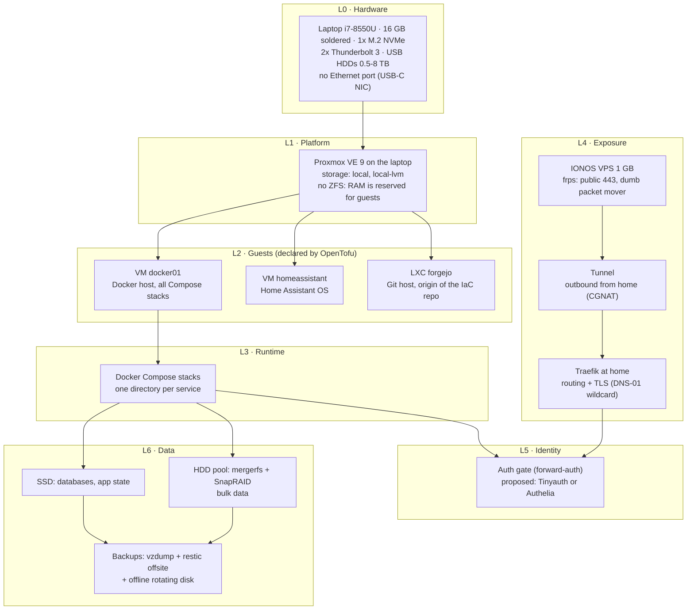
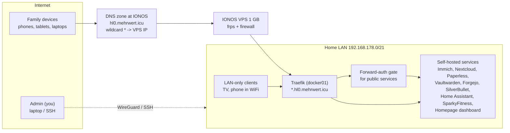
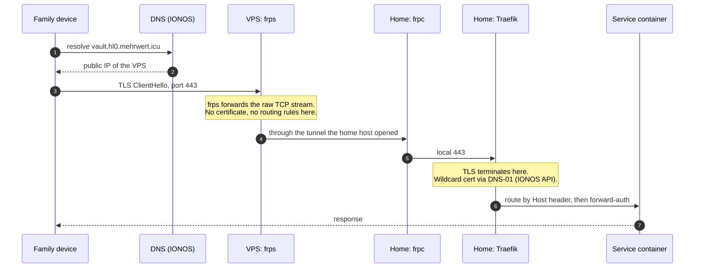
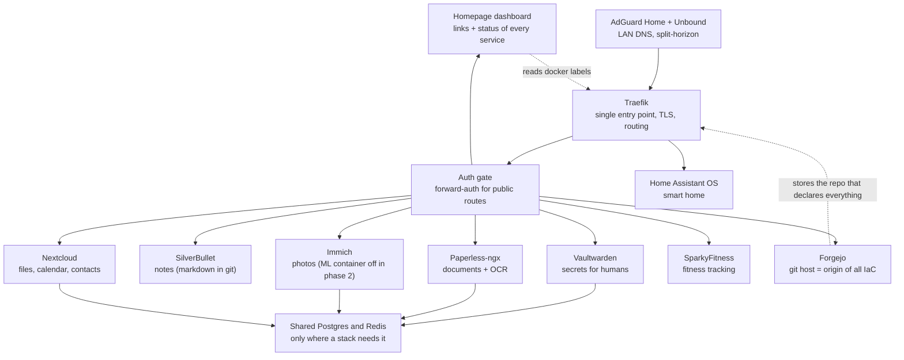
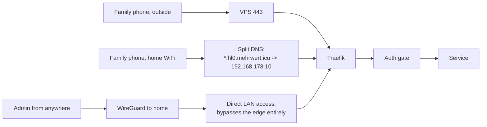
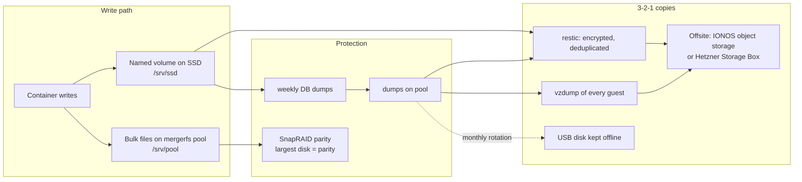

# Architecture Overview

> Read this first. It is the 10-minute version of the whole setup: what runs where,
> how the pieces talk to each other, and where the trust boundaries are.
> Deep dives stay in the other documents (`docs/07`–`docs/12`).
> All diagrams are Mermaid (rendered by Forgejo) — the editable text *is* the diagram.

---

## 1. Design principles

| # | Principle | Consequence |
|---|---|---|
| 1 | **The repository is the source of truth** | Host, guests, services, secrets and DNS all live in Git. Nothing is configured by hand that could be in a file. |
| 2 | **Stateful, declarative tooling only** | OpenTofu (has state, shows a plan) + cloud-init (runs once) + Docker Compose (idempotent). No Ansible, no configuration drift. |
| 3 | **No Kubernetes** | The workload is stateful and fits one node. Orchestration cost > benefit here. If it ever becomes necessary: k3s, one node, not Talos. |
| 4 | **Least software, least surface** | Every extra daemon must justify itself in RAM, maintenance and attack surface. |
| 5 | **The edge stays dumb, identity lives inside** | The public VPS only moves packets. Authentication, routing rules and certificates live on the machine with the resources. |
| 6 | **RAM is the scarce resource** | 16 GB is a hard limit (soldered). The guest list is therefore phased, and `tofu` reports the remaining RAM as an output. |
| 7 | **Reproducibility over convenience** | A rebuild is a rehearsal that is repeated in a lab until it is boring (`docs/11-iac.md`, `lab/`). |

## 2. Layers

## 3. System context — who talks to whom

*Nothing in the home network is reachable from the internet except through the VPS.*
*Requests from the LAN go directly to Traefik (split-horizon DNS), never through the VPS.*

## 4. Edge and transport (the CGNAT problem)

*Why this shape: the VPS is a 1 GB box. It stays a packet mover with a tiny footprint
and nothing to configure when a service is added. Routing, TLS and identity are files
in the repository, applied at home.* Choice comparison: `docs/15-service-choices.md`.

## 5. Service interlock — how the services depend on each other

*Rules: services never talk to each other directly (no implicit coupling); every service
is reachable only through Traefik; state lives in named volumes on the SSD; bulk data
lives in the mergerfs pool.*

## 6. Request paths (three cases)

| Case | Path | Auth |
|---|---|---|
| Public service | VPS → tunnel → Traefik → forward-auth → service | Identity gate (session cookie) |
| LAN client | direct to Traefik (split DNS) | none, but LAN only |
| Admin | WireGuard, then direct (or Proxmox UI on 8006) | WireGuard key + service login |

## 7. Data flows and retention

*SnapRAID protects against a dead disk. It does not protect against deletion, ransomware
or a fire. That is what the offsite copy and the offline rotation are for (`docs/10-backup.md`).*

## 8. Trust boundaries

| Zone | Reachable from | Contains | Compromise impact |
|---|---|---|---|
| Public edge (VPS) | Internet | frps, firewall | Traffic relay only; no data, no credentials beyond a tunnel token |
| Home LAN | Home network | all services, all data | full exposure |
| Guests | LAN | separate VM/LXC per service group | blast radius limited to one guest |
| Git + secrets | LAN, and offsite backup | code, encrypted secrets | needs the offline age key to be useful |

## 9. Failure domains — what still works when something dies

| Failure | Still works | Down | Recovery |
|---|---|---|---|
| One HDD fails | everything (no striping) | nothing, degraded | SnapRAID rebuild onto a replacement (`docs/08-speicher.md`) |
| SSD fails | the pool's bulk data | all guests and databases | reinstall host, `tofu apply`, restore restic (`docs/12-rebuild-runbook.md`) |
| Laptop dies | the VPS edge and the offsite backup | everything at home | install on replacement hardware, same repo |
| VPS dies | LAN access and the offsite backup | public access | re-create the VPS from the edge runbook; DNS points to the new IP |
| DNS provider fails | LAN access (split DNS) | public access | point the zone elsewhere |

## 10. RAM budget (16 GB = 16384 MB)

| Piece | RAM | Phase |
|---|---|---|
| Proxmox host, no ZFS ARC | ~1200 MB | 1 |
| `docker01` (all Compose stacks) | 8192 MB | 1 |
| `homeassistant` | 2048 MB | 1 |
| `forgejo` (LXC) | 1024 MB | 1 |
| Reserve for peaks and updates | ~1900 MB | 1 |
| `immich` (without ML container) | ~4096 MB | 2 |
| `nextcloud` (slim image, not AIO) | ~2048 MB | 3 |
| SparkyFitness, extra monitoring | 512–2048 MB | 4 |

Phase 2 only starts when `tofu output ram_reserve_mb` is positive after enabling it.
Parked services are `enabled = false` in `tofu/nodes.auto.tfvars` — no deletion.

## 11. Deliberately not used

| Not used | Why |
|---|---|
| Kubernetes / Talos | stateful single-node workload, no cluster operations wanted |
| Cloudflare tunnel / DNS | requirement: maximum OSS, own infrastructure |
| Ansible / app-store distributions (HomelabOS et al.) | they own the state and touch things they were not asked to touch |
| ZFS on the laptop | ARC would eat the scarce RAM; USB disks do not want striping |
| PBS in phase 1 | ~2 GB RAM, only worth it once a second node exists |
| Homarr (dashboard) | repository is archived — replaced by Homepage/Glance |
| Pangolin on a 1 GB VPS | upstream asks for 2 GB; the three containers alone report ~650 MB |

## 12. Where the details live

| Topic | Document |
|---|---|
| Storage layout, USB pitfalls, parity rules | `docs/08-speicher.md` |
| Edge, DNS, certificates, family access | `docs/09-netz.md` |
| Backup layers and restore drill | `docs/10-backup.md` |
| The four IaC layers, migration path | `docs/11-iac.md` |
| Rebuild runbook (disaster recovery) | `docs/12-rebuild-runbook.md` |
| Temporal plan, phases, exit criteria | `docs/14-setup-timeline.md` |
| Tool comparisons and the reason for each pick | `docs/15-service-choices.md` |
