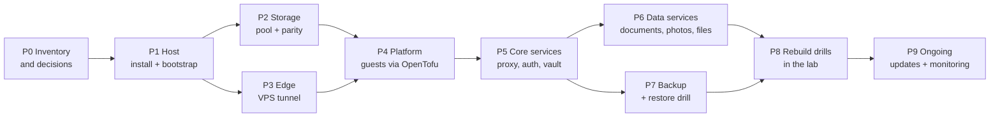

# Setup Timeline

> The build order, phase by phase. Each phase has a **goal**, a **done** definition
> (the gate you must pass before the next phase) and a **fallback** if it fails.
> Durations are working evenings, not calendar time.

## Phase overview

```mermaid
gantt
  title Build sequence (evenings, dependencies matter more than durations)
  dateFormat  X
  axisFormat  %s
  section P0 Decide
  Inventory + decisions        :p0, 0, 1
  section P1 Base
  Host install + bootstrap     :p1, after p0, 1
  Storage pools + SnapRAID     :p2, after p1, 1
  section P2 Edge
  VPS tunnel + DNS wildcard    :p3, after p2, 1
  section P3 Platform
  OpenTofu guests + Forgejo    :p4, after p3, 1
  section P4 Core services
  Traefik + auth + Vaultwarden :p5, after p4, 2
  Homepage + AdGuard           :p5b, after p5, 1
  section P5 Data services
  Paperless                    :p6, after p5b, 1
  Immich (ML off)              :p7, after p6, 2
  Nextcloud                    :p8, after p7, 2
  section P6 Safety
  Backup + restore drill       :p9, after p5b, 1
  section P7 Prove it
  Lab rebuild rounds           :p10, after p9, 2
  section P8 Ongoing
  Renovate + monitoring        :p11, after p10, 2
```

## Dependency chain

---

## P0 — Inventory and decisions (no infrastructure touched)

**Goal:** remove every unknown that would otherwise surface mid-build.

* Exact disk list: size, 2.5"/3.5", own power supply, which one becomes parity.
* Domain and DNS zone at IONOS (`mehrwert.icu` vs `hl0.mehrwert.icu`), API key available.
* Decide which services are public and which stay VPN-only.
* SSH public key for the unattended install.
* Decide: edge transport (proposal: frp) and auth gate (proposal: Tinyauth or Authelia).
* Buy/inspect: powered USB hub or multi-bay enclosure, USB-C gigabit NIC, maybe a 1 TB NVMe.

**Done:** a filled-in decision table (see `docs/15-service-choices.md`) and a disk inventory
with roles assigned.
**Fallback:** none needed — this phase is the fallback.

## P1 — Host install and bootstrap

**Goal:** a running Proxmox host that is already server-shaped.

* Install Proxmox VE (unattended ISO from `hosts/spectre-x360/` or interactive).
* Run `pve-bootstrap.sh` (repos, timezone, lid switch ignored, thermald, USB autosuspend off,
  timer units, OpenTofu API token, static IP).
* Point DNS/reverse lookups sanity check; verify SSH key login only.

**Done:** `pveversion` returns 9.x, `systemctl list-timers` shows snapraid/vzdump units,
the API token exists, host reachable at its static address, survives a reboot with the lid closed.
**Fallback:** interactive install + manual bootstrap steps from `hosts/spectre-x360/README.md`.

## P2 — Storage

**Goal:** the pool exists, is mounted by UUID, and has parity.

* Format the data disks individually (ext4), mount by UUID with `nofail`.
* Create the mergerfs pool at `/srv/pool`, parity disk at `/srv/parity`.
* Install/config `snapraid.conf` (parity = largest disk), first `snapraid sync`, first `scrub`.
* Enable `smartd` for all disks (USB: `-d sat`), configure spindown.

**Done:** `snapraid status` reports no errors, a test file survives a simulated single-disk
removal, the host boots with a disk missing.
**Fallback:** run without parity temporarily (backup takes priority over parity), fix disk
enclosures/power first.

## P3 — Edge

**Goal:** exactly one service is reachable from the internet, through the tunnel.

* DNS: wildcard `*.hl0.mehrwert.icu` → VPS IP, plus an API key with rights to the zone.
* VPS: `frps` (or the chosen transport), firewall allows 22/443 (+ the tunnel port), token set.
* Home: `frpc` as a service, forwarding local 443 to the VPS.
* A throwaway "hello" container at home proves the whole chain end to end.

**Done:** `https://hello.hl0.mehrwert.icu` from a mobile network returns the hello page with
a valid certificate; direct home IP is unreachable from outside.
**Fallback:** plain WireGuard + nftables DNAT on the VPS (also fits 1 GB).

## P4 — Platform guests

**Goal:** guests come from the repository, not from the UI.

* `tofu apply` for `docker01`, `homeassistant`, `forgejo` (production sizing, `plan` first).
* Restore Forgejo data if migrating; otherwise verify the repo is pushed to the anchor and Forgejo.
* Confirm `ram_reserve_mb` is still positive.

**Done:** all guests boot, are reachable, `tofu plan` afterwards reports no changes.
**Fallback:** reduce guest sizing, or park the Home Assistant guest until phase 6.

## P5 — Core services

**Goal:** the front door works — routing, TLS, identity, secrets.

* Traefik with Docker provider, wildcard cert via DNS-01 (IONOS), HTTP→HTTPS redirect.
* Auth gate in front of every public route; one page that requires login to prove it.
* Vaultwarden; Homepage dashboard with service links; AdGuard Home + Unbound for LAN DNS.

**Done:** dashboard reachable, each listed service opens, unauthenticated access to a public
route is refused, certificates renew (check the ACME log once).
**Fallback:** skip the auth gate for now but keep public services at zero.

## P6 — Data services

**Goal:** real data lands on the pool safely. One service at a time, never two.

Order proposed: Paperless → Immich (ML container off) → Nextcloud → SparkyFitness.
For each: create the DB/user, set the upload path on the pool, dump the DB, do one restore test.

**Done:** per service, a document/photo/file survives a container rebuild, and its database
dump has been restored once into a scratch database.
**Fallback:** park the service with `enabled = false`; RAM comes first.

## P7 — Backup and restore drill

**Goal:** the safety net actually works.

* `vzdump` timer for all guests, `restic` offsite with the DB dumps and `/etc/pve`.
* Offline rotation disk: copy, then disconnect.
* **One full restore drill**: restore a guest and one database dump, measure the time.

**Done:** a written result in the runbook: how long the restore took and what was missing.
**Fallback:** if the offsite target is not chosen yet, keep two local copies until it is.

## P8 — Rebuild drills (prove reproducibility)

**Goal:** the same rebuild succeeds twice, without hand work, in the lab.

* Two consecutive green rounds of `lab/drill.sh` against the anchor repository.
* Update `docs/12-rebuild-runbook.md` with anything you had to do by hand.

**Done:** two green rounds in a row, results committed under `lab/results/`.
**Fallback:** fix the drill, not the doc — the drill is the specification.

## P9 — Ongoing

**Goal:** it stays healthy without attention.

* Renovate (or equivalent) opens update pull requests; you merge at your pace.
* Monitoring: Beszel for the host, Uptime Kuma for the URLs; alert to a channel you read.
* Quarterly: SnapRAID scrub, restore spot check, secret rotation.

**Done:** the first Renovate PR was reviewed and merged, an alert was received in a test case.
